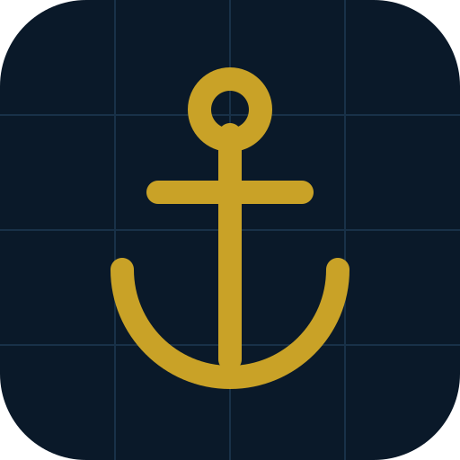

# Ada Translate

Çevrimdışı çalışan **İngilizce ↔ Türkçe denizcilik sözlüğü**. Tüm veriler cihazınızda, internet bağlantısı gerekmez.

Kaptan Oğuz Yağbasan tarafından M/T ADA için hazırlanmıştır — chartering, chemical tanker, genel denizcilik terimleri ve kısaltmalar.

## Özellikler

- **Tamamen çevrimdışı** — tüm veriler cihazda, sunucuya yüklenmez
- **EN ↔ TR** çift yönlü arama
- Kategori filtreleri (chartering, chemical tanker, genel vb.)
- Kısaltmalar, A–Z dizini, favoriler
- Flashcard (quiz) modu
- JSON dışa aktarma

## Teknoloji

- Saf web (HTML/CSS/JS) arayüz
- **Tauri** (Rust) masaüstü kabuğu — Electron yerine, ~2 MB
- Veri: `data/*.json` denizcilik terim bankası

## Kurulum

- **Windows:** `PhotoTimestamp_1.0.0_x64-setup.exe` (veya `.msi`) çift tıklayıp kurun
- **Linux:** `.deb` paketini kurun
- **Tarayıcı:** `dist-web/index.html` dosyasına çift tıklayın

## Ekran Görüntüsü

## Lisans

MIT — Kaptan Oğuz Yağbasan
