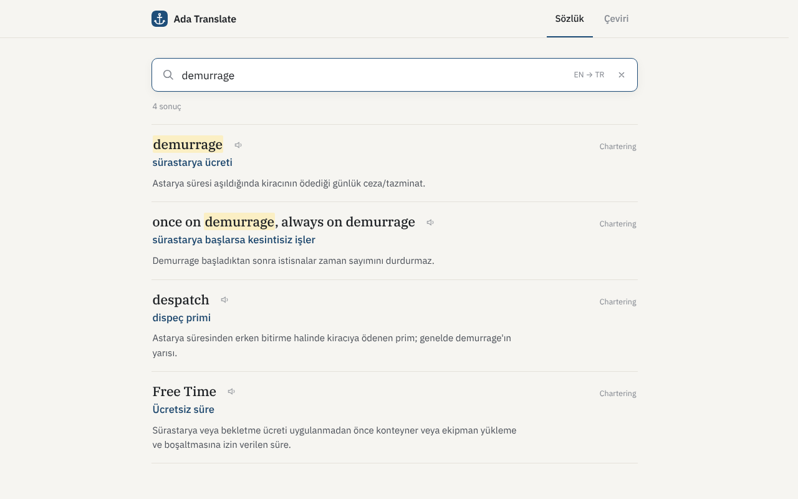
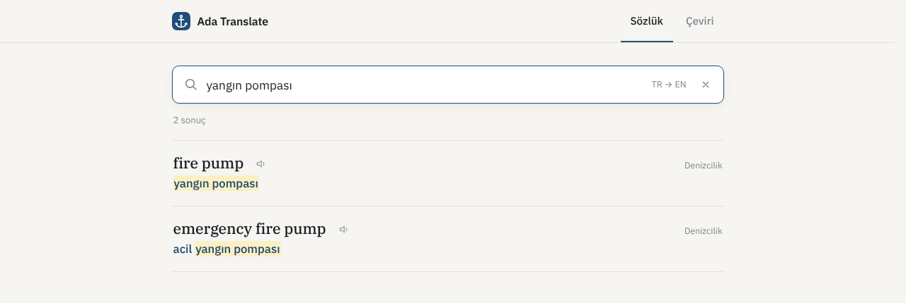

# Ada Translate

A fully **offline** English ↔ Turkish maritime dictionary with **sentence translation**.
It also covers general English (Oxford 3000, PET B1, phrasal verbs, correspondence phrases).
Made for ship's crew, chartering/operations, technical & purchasing staff, and medical officers. The interface is in Turkish.



## Download

Get the latest Windows portable `.exe` (or `.zip`) and Linux AppImage from the [Releases](https://github.com/kaptanoguz/AdaTranslate/releases/latest) page. No installation and no internet needed; the translation models are included.

## How to run

**Desktop app (recommended):** `Ada Translate.exe` (Windows portable) — everything works.

**Development:**

```bash
npm install
bash tools/get_models.sh   # translation models (~1 GB, once)
npm start            # open with Electron
./baslat.sh          # open in the browser (Linux/macOS) — Windows: baslat.bat
```

It can also be opened by double-clicking `index.html`; the dictionary works then, but sentence translation
doesn't (browsers don't allow the translation model to load under `file://`).

## Features

- **Dictionary** — 5,500+ terms (general English, maritime, chartering, chemical tankers, ship supply, medical).
  Instant search, typo tolerance, ignores Turkish accents; the direction (EN→TR / TR→EN) is detected automatically.
  Recognises inflected and irregular forms (*went → go, children → child, stopped → stop*).
  Every result shows its category, definition and a pronunciation button.
- **Translation** — large OPUS-MT models (Helsinki-NLP) run entirely on the device in both directions.
  Dictionary terms found in the text are listed below the translation (Turkish suffixed forms are recognised too:
  *makine dairesinde → engine room*). `Ctrl+Enter` translates immediately, `⇄` switches direction.
- Light / dark theme follows the system setting. Keyboard: `/` search box, `Esc` clear.



## File structure

```
AdaTranslate/
├── index.html · manifest.json · sw.js
├── electron-main.js        # desktop shell (app:// protocol, COOP/COEP)
├── css/style.css
├── js/
│   ├── data-bundle.js      # GENERATED — built from data/*.json
│   ├── search.js           # normalisation, scoring, fuzzy matching, stemming, terms in sentences
│   ├── translate-worker.js # offline translation (Web Worker)
│   └── app.js              # interface
├── data/*.json             # dictionary source (general_a…e, maritime, chartering, …)
├── models/en-tr, tr-en     # ONNX translation models (int8)
├── vendor/                 # transformers.js + onnxruntime-web (WASM)
└── tools/                  # build_bundle.py, validate.py, smoke.js, fix_tokenizer.py
```

## After changing the data

```bash
npm run verify       # rebuilds the bundle, validates the data, runs the tests
npm run build        # verification + Windows portable/zip
```

## Releases

Pushing a version tag builds the Windows portable/zip and the Linux AppImage on GitHub Actions and publishes them as a release (`.github/workflows/release.yml`):

```bash
git tag v2.0.0 && git push origin v2.0.0
```

The workflow can also be started from the Actions tab (**Release → Run workflow**); it then uses the version in `package.json`.

## Licenses

Translation models: Helsinki-NLP OPUS-MT (CC-BY 4.0) — `opus-mt-tc-big-en-tr`, `opus-mt-tc-big-tr-en`.
The word order in the tokenizer.json files of the onnx-community packages is wrong; if the models are updated,
fix them with `tools/fix_tokenizer.py`.
Runtime: transformers.js (Apache-2.0), onnxruntime-web (MIT).
